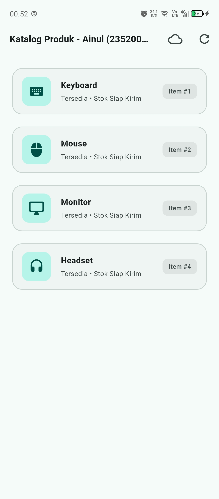

## Tugas Praktikum 5: Uji Ketiga State (AsyncValue Riverpod)

**Identitas Mahasiswa**
- **Nama:** Ainul (Ainul Ma'arif Al Mashuri)
- **NIM:** 23520010
- **Mata Kuliah:** Pemrograman Perangkat Bergerak
- **Topik:** Tugas Praktikum 5: Uji Ketiga State (`AsyncValue`, `AsyncNotifier`, & Error Recovery) — Modul 06 Halaman 29–31

---

## 1. Ringkasan Eksekutif

## Catatan 
State Loading: Saat aplikasi pertama kali dibuka, layar menampilkan animasi spinner memuat data selama 2 detik akibat penundaan Future.delayed.
State Error: Saat kode sengaja melempar galat (throw Exception), antarmuka tidak mengalami crash layar putih, melainkan menampilkan pesan error dan tombol Coba lagi.
State Recovery: Saat tombol Coba lagi ditekan, fungsi ref.invalidate() mereset provider dan memuat ulang data hingga daftar produk (Keyboard, Mouse, Monitor) berhasil muncul kembali.