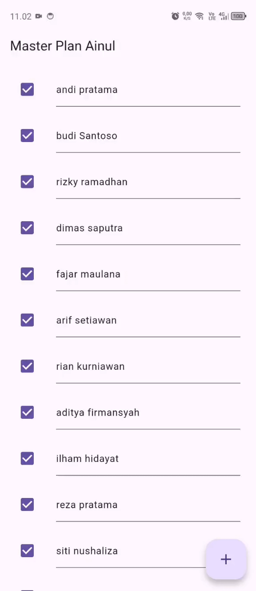
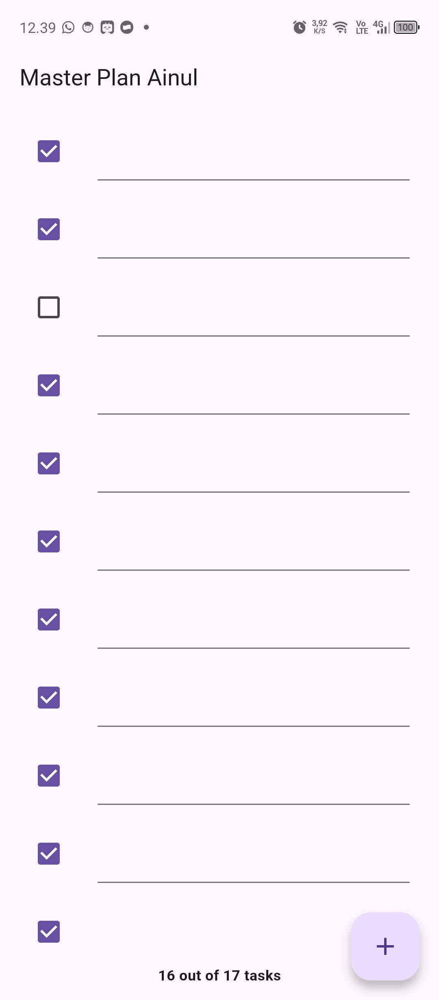
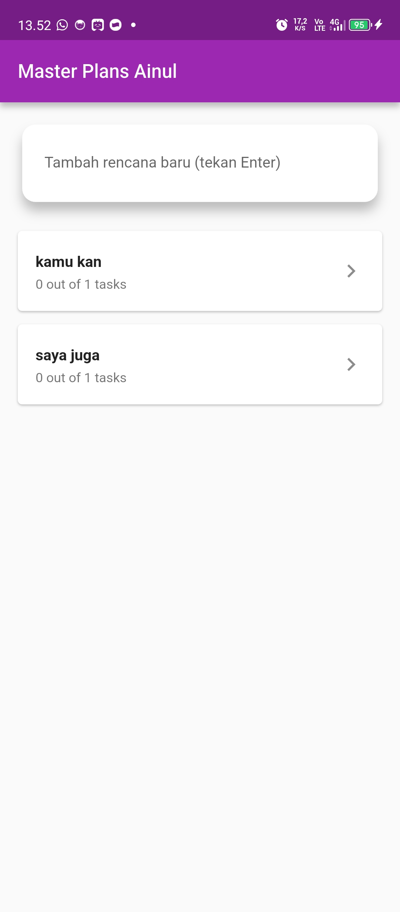
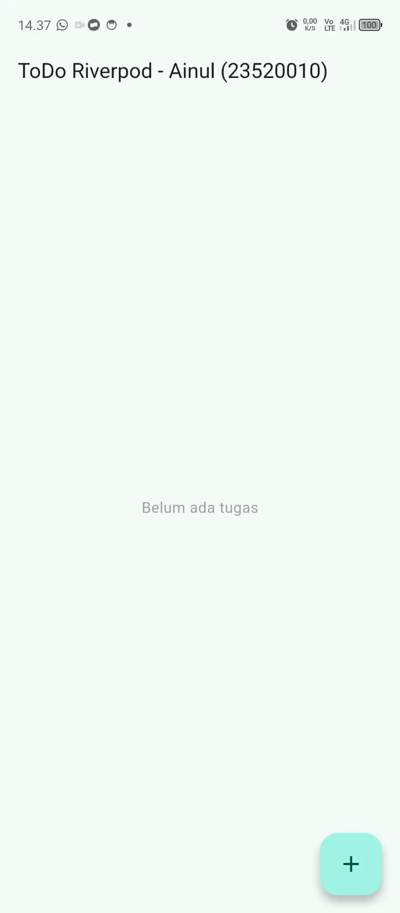

# Laporan Praktikum Flutter - Navigasi dan Pemrosesan Rute

**Identitas Mahasiswa**
- **Nama:** Ainul Ma'arif Al Mashuri
- **NIM:** 23.52.0010
- **Mata Kuliah:** [Isi dengan nama mata kuliah, misal: Pemrograman Perangkat Bergerak]

## Demo Aplikasi
Berikut adalah hasil akhir dari aplikasi yang telah berjalan dengan lancar beserta animasi transisinya:

## Catatan Perbaikan Kode (Error Handling)
Selama pengerjaan, terdapat penyesuaian kode agar aplikasi berjalan optimal:
- **RenderFlex Overflow:** Menyesuaikan nilai `childAspectRatio` pada `GridView` agar elemen di dalam kartu (gambar dan teks) tidak keluar dari batas layar (overflow) pada ukuran layar yang berbeda.
- **Null Safety pada Arguments:** Memastikan proses *type casting* pada `ModalRoute` dilakukan dengan aman agar tidak terjadi *null check operator error* saat data objek dikirimkan.

## Praktikum 2: Data Layer dengan InheritedWidget & InheritedNotifier

# Catatan
Soal 2: InheritedWidget dan Alasan Memilih InheritedNotifier
InheritedWidget membagikan data ke widget di bawahnya tanpa oper data manual. Dipilih InheritedNotifier karena otomatis memantau perubahan data pada ValueNotifier dan langsung memperbarui tampilan, sementara InheritedWidget biasa hanya menyalurkan data statis.
Soal 3: Maksud dan Alasan Method pada plan.dart
Method ini menghitung tugas selesai dan menampilkan teks progres (contoh: 1 out of 3 tasks). Tujuannya memisahkan logika hitung data di Model agar kode tampilan (View) tetap bersih.
Soal 4: Penjelasan Hasil Langkah 9
Menampilkan indikator progres tugas di bagian bawah layar (footer). Saat tugas ditambah atau dicentang selesai, teks progres otomatis terbarui secara langsung (real-time).

## Praktikum 3: Membuat State di Multiple Screens

# Catatan
Soal 2 (Maksud Diagram Widget Tree):
Menaruh PlanProvider di pucuk teratas pohon widget agar status data menjadi global. Saat berpindah layar via Navigator.push, kedua layar tetap berbagi satu sumber data yang sama tanpa perlu oper data bolak-balik.
Soal 3 (Penjelasan Hasil Langkah 14):
Pengguna bisa membuat banyak daftar rencana di layar utama. Saat salah satu rencana dibuka dan tugasnya diubah, progres pada layar utama otomatis ikut terbarui secara sinkron.

## Praktikum 3: Membuat State di Multiple Screens

# Catatan
Praktikum ini menerapkan pustaka manajemen status modern flutter_riverpod untuk memisahkan logika aplikasi sepenuhnya dari antarmuka pengguna secara compile-safe.
- Penyedia Data (TodoListNotifier): Mengelola operasi tambah, centang, edit, dan hapus tugas secara immutable (selalu membuat salinan objek baru, bukan memodifikasi data lama secara langsung).
- Wadah Global (ProviderScope): Membungkus akar aplikasi di main.dart agar status daftar tugas dapat diakses dari mana saja.
- Tampilan Reaktif (ConsumerWidget): Menggunakan ref.watch di dalam metode build() agar layar otomatis menggambar ulang saat data berubah, dan menggunakan ref.read pada tombol aksi agar metode mutasi terpanggil tanpa memicu rebuild berlebih.

